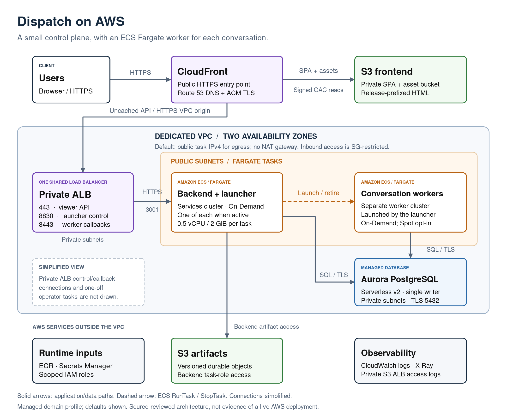

# Dispatch AWS architecture explained

Source review of module revision `e3a3c2a`. This describes the infrastructure in
this repository, not an observed AWS deployment. The repository explicitly marks
live fresh-account qualification as pending.

## In one sentence

This module builds a dedicated AWS installation for Dispatch: a web frontend,
two small application controllers, per-conversation Fargate workers, and durable
PostgreSQL/S3 storage.

The key distinction is **Terraform manages the infrastructure and controller
services; Dispatch's launcher manages individual conversation tasks**. This is
not an ECS service that keeps a fixed number of workers running.

## Architecture diagram

[Scalable SVG](architecture.svg) · [Editable diagrams.net / Draw.io source](architecture.drawio)

The diagram shows the **managed-domain profile** (`domain` supplied), default
`task_egress = "public-ip"`, and Aurora database mode. It collapses the two AZs
and groups backend/launcher tasks for readability. It shows an active installation,
not the initial zero-task foundation. Private controller/callback connections,
S3 gateway routing, supporting-service connections and operator tasks are omitted.
The sections below explain those paths. Draw.io uses ordinary editable shapes;
there are no external image dependencies.

## 1. Repository and ownership boundaries

All root-level `.tf` files form **one reusable module**, split by concern rather
than into child modules. [`examples/complete`](../examples/complete/main.tf) is a
caller root that supplies providers and passes inputs into it.

| Owner | Responsibility |
| --- | --- |
| This module | Dedicated VPC/subnets, AWS storage/database resources, ingress, ECS clusters/services/task definitions, IAM, security groups, configuration rendering and telemetry infrastructure |
| Caller/operator | Account/region, restricted Terraform state backend, existing public hosted zone, stable installation identity, trusted certificates/CAs, retained application secret values, image selection, frontend publication, initialization and activation |
| Dispatch runtime | Database schemas and ownership protocols, conversation execution, launching/retiring workers, recovery and application lifecycle commands |

The module does not configure a state backend or embed provider credentials.
[`versions.tf`](../versions.tf) declares engine `>= 1.12.6, < 2.0.0` and pins the
AWS provider to `6.67.0`. The caller supplies its regional provider and an
`aws.edge` provider in **us-east-1** for CloudFront's viewer certificate. Declared
version constraints are not proof that every allowed version is qualified.

## 2. How a request moves through the system

### Browser and API

1. Route 53 aliases the chosen application hostname to **CloudFront**. ACM
   supplies viewer TLS in us-east-1 and a separate regional ALB certificate.
2. CloudFront serves the single-page application from a **private S3 frontend
   bucket**, using signed Origin Access Control (OAC) reads. HTML is selected
   through `frontend_release_prefix`; shared `/assets/*` objects stay outside
   that release prefix so old clients can still load their hashed assets.
3. `/api` and `/api/*` use a **CloudFront VPC origin** to reach the private ALB
   over HTTPS. API caching is disabled, and viewer headers, cookies and queries
   are forwarded. The OAuth callback GET query is a deliberate exception: an
   edge function strips it before ALB access logging.
4. The ALB forwards API traffic to the **backend on HTTPS port 3001**. The backend
   handles application/API concerns and uses PostgreSQL-backed stores and S3
   artifacts. With a managed domain it does not serve the frontend itself.

SPA rewrites apply only to static navigation, not to API errors. Real CDN/API/SSE
streaming and provider callback behavior still require live qualification.

Sources: [`frontend.tf`](../frontend.tf), [`domain.tf`](../domain.tf),
[`services.tf`](../services.tf), [`configuration.tf`](../configuration.tf).

### Conversations and execution

- **Backend:** the application entry point; its generated configuration includes
  auth, provider credentials, MCP catalog, routing, directory and worker-store
  provisioning. It can read/write only the artifact bucket's `artifacts/*` prefix.
- **Launcher:** a separate ECS service with its own PostgreSQL journal. It receives
  the chosen worker task-definition revision and has scoped ECS RunTask,
  Describe/List/StopTask and worker-role PassRole permissions for the **worker
  cluster**, not arbitrary application administration.
- **Workers:** individual Fargate tasks started by the launcher for conversations.
  Terraform registers their definition but creates **no worker ECS service**.
  They have a separate task role and do not receive the controllers' secret bundles
  or RDS master credentials through their static task definition.

There are two normal ECS clusters: `<name>-services` and `<name>-workers`.
Both controllers and workers are sized at **0.5 vCPU / 2 GiB per task** in the
current source. Controllers stay On-Demand; worker Spot is opt-in. Local worker
files, installed packages and unpushed commits are disposable—**there is no EFS
or other durable workspace filesystem**.

The intended invariant is one active executor per conversation. Its enforcement
belongs to the compatible Dispatch runtime and termination protocol, not to the
Terraform resource graph alone.

Sources: [`services.tf`](../services.tf), [`security.tf`](../security.tf),
[`configuration.tf`](../configuration.tf), [`spot.tf`](../spot.tf).

## 3. Networking: private ingress, public task egress by default

[`foundation.tf`](../foundation.tf) creates a new VPC, one public and one private
subnet in each of **exactly two AZs**, an internet gateway, route tables and an
S3 gateway endpoint attached to both route tables.

The default is deliberately cost-conscious:

- **ALB and PostgreSQL stay in private subnets.**
- Running Fargate tasks use public subnets with assigned public IPv4 addresses
  for outbound HTTPS to AWS services and external providers.
- A public task address does **not** create public application ingress: inbound
  rules reference the relevant security groups and ports. Managed-domain API
  traffic enters through CloudFront, not a public ALB bypass.
- `task_egress = "nat"` instead puts tasks in private subnets and creates **one**
  NAT gateway/EIP. This is not redundant multi-AZ NAT egress.
- Ordinary tasks and operator tasks use the selected task networking outputs:
  `task_subnet_ids` and `task_assign_public_ip`.

### One ALB, three separate listener paths

For the managed-domain profile, the private API ALB is also the private control
ALB; the module does **not** deploy two load balancers in this profile.

| Caller | Listener | Destination / purpose |
| --- | --- | --- |
| CloudFront VPC origin | HTTPS 443 | Backend HTTPS 3001; viewer `/internal` and `/internal/*` requests are denied |
| Backend | HTTP 8830 | Launcher HTTP 8830; private control traffic |
| Workers | HTTPS 8443 | Backend HTTPS 3001; only `/internal/workers/*` paths are forwarded |

Workers cannot use the callback listener as a general maintenance API. Callback
DNS is private. Launcher control is **HTTP inside the VPC**, not TLS; its
configuration supplies an application token. Backend-to-worker traffic uses port
8831. AWS Cloud Map supplies private controller service discovery and direct peer
communication for rolling handover. Activation reaches the backend directly over
private HTTPS, not through a public listener.

With `domain = null`, CloudFront/frontend storage/managed certificates are absent.
The caller can supply certificates and configure an internal or public API ALB.
A caller-owned **public** API ALB retains a separate private launcher/callback ALB;
its callback listener uses port 443 instead of the shared ALB's 8443.

Sources: [`task-network.tf`](../task-network.tf), [`security.tf`](../security.tf),
[`launcher-alb.tf`](../launcher-alb.tf),
[`backend-callback-alb.tf`](../backend-callback-alb.tf).

## 4. Durable data and secrets

### PostgreSQL

The default is **Aurora PostgreSQL Serverless v2**, with one `db.serverless`
writer, **0.5–4 ACUs**, and no reader or RDS Proxy. The alternative is ordinary
RDS PostgreSQL: `db.t4g.small`, 20 GiB gp3 initially, storage autoscaling up to
100 GiB, and `multi_az = false`.

Both modes configure encryption, forced SSL, seven-day backups, deletion
protection, final snapshots and Terraform destruction guards. They also suppress
SQL/parameter logging that could expose provisioning credentials.

The application expects **seven logical databases/roles**—`auth`, `provider`,
`catalog`, `directory`, `routing`, `launcher`, `workers`—not seven RDS instances.
A separately invoked initializer creates/verifies this contract. Terraform does
not initialize the stores, migrate schemas or make switching database modes a
data migration.

Sources: [`database.tf`](../database.tf),
[`database-variables.tf`](../database-variables.tf), [`operator.tf`](../operator.tf).

### S3 and credentials

There are three bucket purposes in the managed-domain profile:

- **Frontend:** private, encrypted SPA release HTML and shared assets; protected
  from Terraform destruction. Terraform creates the bucket but does not upload
  the release.
- **Artifacts:** private, encrypted, **versioned** durable objects, with a
  destruction guard and backend task-role access.
- **ALB access logs:** private, encrypted, with lifecycle expiry, seven days by
  default. URLs/query strings can be sensitive despite short retention.

The `application` input takes **secret ARNs, not resolved secret values**: seven
DB URL references, three encryption keys, five tokens, and a backend private-key
reference. The operator must populate and retain those Secrets Manager values
outside Terraform. RDS separately manages the master secret; **only the database
initializer receives it**, never normal controllers/workers.

ECS execution roles resolve the authorized secrets at task start.
`dispatch-bootstrap` materializes restricted task-local files from the generated
configuration. This reduces accidental exposure; it does not make injected
secrets invisible to authorized ECS operators or remove the need to protect state,
plans, task metadata and logs.

Sources: [`foundation.tf`](../foundation.tf), [`frontend.tf`](../frontend.tf),
[`configuration-variables.tf`](../configuration-variables.tf),
[`configuration.tf`](../configuration.tf), [`access-logs.tf`](../access-logs.tf).

## 5. An apply is not a complete installation

The initial defaults are `image = null`, `application = null`, `desired_count = 0`,
with all operator switches disabled. This creates the selected billable foundation,
not a serving application. With no controller image, ordinary controller services
and worker task definitions are not created.

The intended installation sequence is:

1. **Apply foundation** after reviewing identity, state, networking and costs.
2. **Prepare retained secrets/trust**, select compatible digest-pinned controller
   and worker images, and publish a verified frontend release separately.
3. **Initialize and verify PostgreSQL** with the optional one-off initializer
   while application owners are actually stopped. Remove initializer authority
   afterward.
4. **Enroll/authorize credentials** using a separate optional maintenance cluster
   and private ECS Exec terminal. This terminal receives only auth/provider
   credentials, not database master or activation authority; its session/container
   output is intentionally not logged. Stop it and remove its authority afterward.
5. **Start launcher, then backend**, using per-service count overrides as needed.
6. **Activate privately** with the dedicated one-shot operator task. It waits on
   authenticated owner status and sends `/internal/undrain`; fresh admission is
   closed until activation. Do this before waiting for admission-dependent readiness.
7. **Verify real behavior**: login, model reply, harmless tool execution, retained
   history, artifact access and worker lifecycle—not merely a landing-page HTTP 200.

Terraform only **registers** initializer, maintenance and activation task
definitions. It does not invoke them with hidden provisioners. Operator helpers
preview locally and require explicit execution/receipts for mutations. A successful
RunTask submission is not proof that a task completed; confirm actual termination
and all container exit codes, and reconcile uncertain results rather than replaying.

Follow [`installation.md`](installation.md), not this summary, for execution.

## 6. Important defaults and operational tradeoffs

| Setting | Current behavior |
| --- | --- |
| Controller count | Zero initially; zero or one steady backend/launcher owner, not arbitrary horizontal scaling |
| Controller updates | Rolling 100%/200% by default; temporary overlap requires runtime handover support and readiness checks; stop-first is an explicit downtime option |
| Worker updates | New task-definition revision affects newly launched attempts; existing workers are not automatically replaced |
| CPU architecture | `ARM64` by default; the documented 0.2.0 AMD64 archive import instead requires `X86_64` |
| Worker privilege | Module default is non-root/read-only; `worker_package_installation = true` allows trusted root/writable workers. The complete example opts in whenever `worker_image` is supplied |
| Database pause | Disabled by the default 0.5-ACU floor. Set minimum to zero only with a supported engine/region; every DB connection must close before the pause interval starts |
| Conversation workers | Compatible Dispatch images automatically retire idle assigned workers. Current application source defaults to sixty minutes; older images can differ. `worker_idle_timeout_seconds` sets an explicit timeout independently of the image default; zero disables new automatic retirements. The warm spare remains available. |
| Telemetry | CloudWatch logs default to seven days; optional ADOT sidecars export to X-Ray with 10% application sampling by default; X-Ray retention is separate |

**This is not an HA guarantee.** Two AZs provide subnet placement, but there is
one steady instance of each controller, one Aurora writer without a failover
reader, or a single-AZ RDS instance. Optional NAT also has a single gateway.
Root-enabled coding workers are for trusted work, **not hostile-code isolation**.

**Zero tasks does not mean zero cost.** ALB, storage, DNS and secrets remain.
The repository's [dated us-east-1 cost model](../releases/idle-cost-estimate.md)
estimates approximately **$26.73/month** fixed/assumed-storage when all tasks are
stopped and Aurora has actually paused, or **$111.86/month** with two controllers
continuously running and Aurora at 0.5 ACU, before workers and usage. These are
conditional planning subtotals, not current quotes, measured bills or total spend
limits; model/MCP usage and other listed exclusions are additional.

Sources: [`variables.tf`](../variables.tf), [`services.tf`](../services.tf),
[`tracing.tf`](../tracing.tf), [`operations.md`](operations.md).

## 7. What to check before treating this as deployment-ready

- The source calls out **pending live qualification**. Mock tests and published
  source are not proof of image pulls, successful bootstrap, streaming, private
  activation, Spot recovery, Aurora pause or production availability.
- Confirm regional engine availability. The current Aurora version default is
  `18.6.1`; its presence in source is **not** confirmation that AWS offers that
  version with the required Serverless/auto-pause behavior in your target region.
- Pin an immutable module revision and verified image digests with matching CPU
  architecture. The [release guide](../releases/README.md)
  describes public image digests and optional ECR mirroring. Module/application
  qualification remains separate from artifact publication.
- Frontend publishing is a separate release operation. Use the released archive and its published SHA-256
  with the frontend publisher; no compatibility manifest is required.
- Retain databases, artifacts and their matching encryption/token secrets.
  Destruction guards are intentional; changing a name, database mode or hostname
  is not a harmless application update. The hostname also affects passkey identity.

Two small documentation inconsistencies are worth knowing when following the
operator instructions; this review leaves existing infrastructure/docs unchanged
apart from this guide and the README link:

1. The `database_initializer` description in [`outputs.tf`](../outputs.tf) names
   `credential_maintenance.cluster_arn`. The installation guide and
   [`run-operator.py`](../scripts/run-operator.py) use **`service_cluster_arn`** for
   database initialization; the initializer output has no maintenance cluster.
2. [`scripts/README.md`](../scripts/README.md) still mentions `private_subnet_ids`
   and disabled public addressing. The helper actually consumes
   **`task_subnet_ids` / `task_assign_public_ip`**, matching the current selectable
   egress design and installation guide.

## Verification scope for this explanation

Reviewed all root Terraform files, caller example, templates, mock-plan tests,
installation/operations/release documentation and the operator request builder.
Ran **34 offline Python tests**, **9 operator-request cases**, edge-function checks
and activation-template syntax checking successfully. Diagram XML was validated
and the PNG visually inspected. No Terraform infrastructure files were changed;
no AWS plan/apply, image pull, secret lookup or live deployment was performed.
